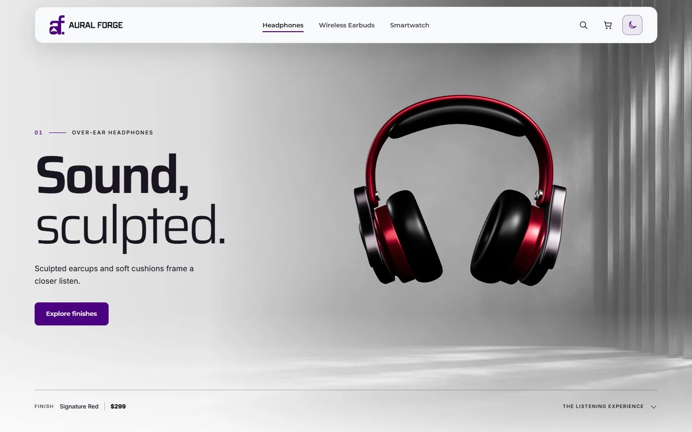
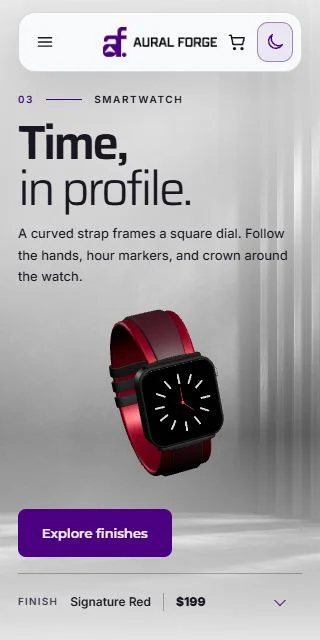
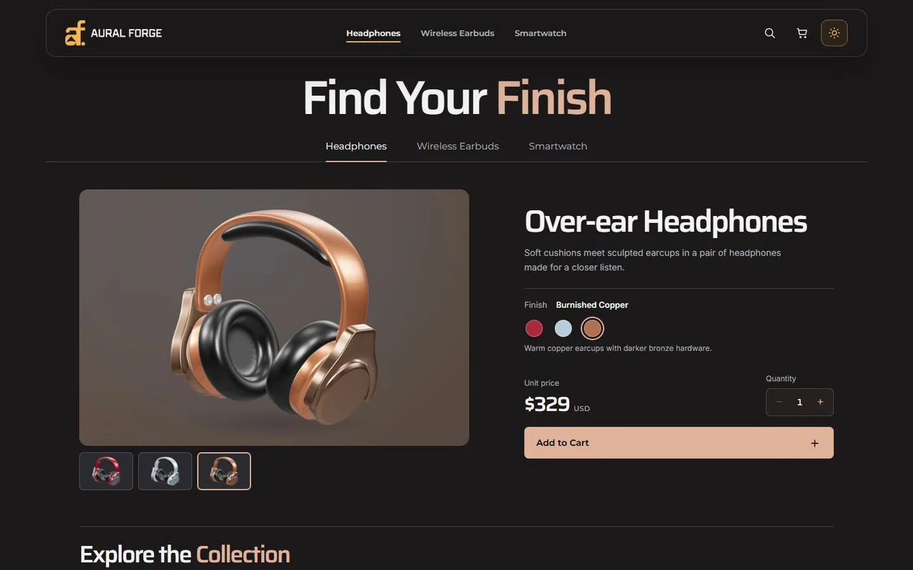

# Aural Forge

An immersive 3D storefront for headphones, wireless earbuds, and a smartwatch.

**[Live Demo](https://aural-forge-henna.vercel.app/)**



## Overview

Aural Forge is a portfolio project that brings product storytelling and the shopping flow into one responsive experience. Scroll to follow each product's reveal, drag to inspect its details, then compare finishes and try the cart and checkout. A shared WebGL scene carries the product through the story, and a matching still keeps the Hero visible while its model loads.

## V1 to V2

The original V1 landing page used HTML, Tailwind CSS, and vanilla JavaScript. Static product imagery and simple scroll animations established the visual direction for a single pair of headphones. [View V1](https://headphone-landing-page-five.vercel.app/)

V2 builds on that foundation with a Next.js and React architecture, three real-time product models, and a scroll sequence that coordinates the camera, lighting, and product poses. Visitors can switch product families, inspect a model from different angles, compare finishes, and go through a complete demonstration checkout. [View V2](https://aural-forge-henna.vercel.app/)

## Key features

- **Three product stories.** Headphones separate at the pads and covers, wireless earbuds lift from their charging case, and the smartwatch settles into a dial-focused view.
- **360° product inspection.** Drag horizontally with a mouse or touch to rotate. Vertical tilt is bounded, and vertical touch gestures can still scroll the page.
- **Finish configurator.** Compare Signature Red, Ice Silver, and Burnished Copper for each product family. The selected finish drives the images, live materials, and cart line item.
- **Responsive storefront.** Mobile navigation and Dark and Light themes adapt the same product experience across screen sizes.
- **Cart and demonstration checkout.** The cart persists in the browser. Checkout validates the form and asks for explicit confirmation before creating a local order. No payment is collected, no shipment is created, and contact and shipping details are excluded from the saved order.

## Technology stack

| Area | Technologies |
| --- | --- |
| Framework and UI | Next.js 16.3.7 App Router, React 19.2.8, JavaScript |
| Real-time 3D | Three.js, React Three Fiber, and Drei for GLB loading and scene lighting |
| Motion | GSAP and ScrollTrigger for scroll choreography and transitions |
| Styling | CSS Modules, global CSS variables, and fonts loaded with `next/font` |
| Tooling and hosting | npm, ESLint, and Vercel |

## Getting started

Use Node.js 20.9 or later and npm. Local development requires no project-specific environment variables.

```bash
git clone https://github.com/M-Taimoor00782/aural-forge.git
cd aural-forge
npm ci
npm run dev
```

Open [localhost:3000](http://localhost:3000).

```bash
npm run lint    # Check the project with ESLint
npm run build   # Create a production build
npm run start   # Serve the production build locally
```

## Project structure

```text
aural-forge/
├── src/
│   ├── app/          # App Router pages, layout, and global styles
│   ├── components/   # WebGL scene, product stages, scroll controllers, and UI
│   ├── config/       # Product families, finishes, and choreography settings
│   └── lib/          # Animation helpers, responsive framing, and browser stores
├── public/
│   ├── images/       # Hero and banner artwork, plus finish renders
│   └── models/       # GLB assets for the three product families
├── scripts/          # Earbuds GLB inspection utility
└── docs/screenshots/ # Screenshots of the deployed experience
```

## Performance and accessibility

- One persistent, on-demand WebGL canvas serves the product story. The active model loads first, the headphones GLB uses Draco mesh compression, and the Hero shows a finish-matched WebP during loading.
- Responsive framing adapts the models and artwork to the viewport. The banner uses separate wide and compact image compositions.
- The inspection surface is keyboard focusable. Arrow keys rotate and tilt the product, and Home or Escape resets the view. Reduced-motion settings simplify the scroll presentation and remove easing from manual inspection.

## Screenshots

| Mobile Hero | Finish configurator |
| --- | --- |
|  |  |

## Author and credits

Built by [Muhammad Taimoor](https://github.com/M-Taimoor00782). Typography uses Saira, Montserrat, and Inter via Google Fonts.

The repository does not include a project license or source and license records for its product models and artwork.
